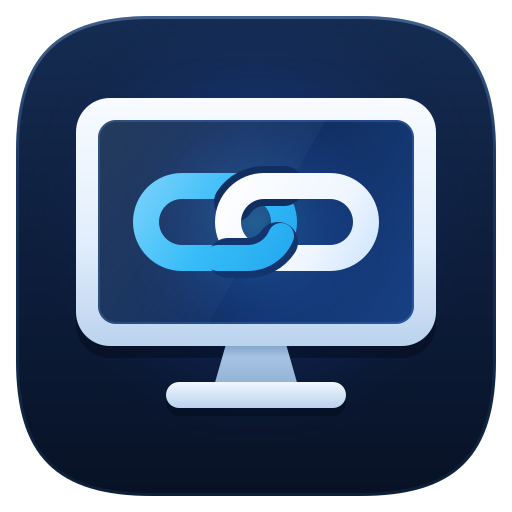

# Remote Mac



View and control your Mac desktop from Windows. The Mac host captures one
display at a time. The Windows viewer supports keyboard and mouse control,
fullscreen, modifier mapping, and plain-text clipboard transfer.

## Repository layout

| Path | Contents |
| --- | --- |
| `apps/mac-host/` | macOS menu-bar app, screen capture, virtual displays, input, and Python host |
| `apps/windows-viewer/` | Python viewer, launcher, and bundled dependency versions |
| `packages/protocol/` | Shared ports, authentication, and message framing |
| `assets/branding/` | Logo and platform icons |
| `scripts/` | Local setup and packaging |

## Build and pair on LAN

Use a trusted LAN and leave the Mac awake, logged in, and unlocked while
setting up. There is one approved Windows PC per Mac host.

1. On the Mac, install Xcode command-line tools and Python 3.10 or newer
   with TLS 1.3 support. From the repository root, run:

   ```sh
   scripts/setup-mac-lan.sh
   scripts/build-mac.sh MAC_LAN_IP /absolute/path/to/python3
   ```

   The setup script creates the local certificate if needed and prints
   its SHA-256 fingerprint. Keep the private key on the Mac. The build
   produces `dist/Remote-Mac-Mac-Host.zip`. The app uses the selected
   Python installation, so build it on the Mac where it will run.

2. Extract and open **Remote Mac Host.app**. Grant it **Screen & System
   Audio Recording** and **Accessibility**, then reopen it if macOS
   asks. Choose **Pair Windows PC…** in the menu bar, confirm the PC's
   LAN IPv4 address, and choose **Copy pairing key** to transfer it
   privately. **Show paired key…** lets you retrieve it again. **Revoke
   Windows PC…** stops the host and invalidates the credential.

3. To build the Windows x64 bundle, install Python 3.10 or newer with
   pip and a MinGW-w64 x64 compiler on the build machine. On a Mac, the
   Homebrew `mingw-w64` formula provides the compiler.

   ```sh
   python3 scripts/build-windows.py MAC_LAN_IP CERTIFICATE_SHA256_FINGERPRINT
   ```

   Transfer `dist/Remote-Mac-Python-Windows-x64.zip` to Windows and extract
   it. Double-click **Remote Mac.exe** with the bundled `runtime` folder
   beside it. Enter the pairing key once to save it in Windows Credential
   Manager. If you re-pair on the Mac, run **Replace pairing key.cmd**
   once to update the saved key.

The build scripts write artifacts to `dist/`. Host credentials stay in
`~/Library/Application Support/Remote Mac Host/`. The two LAN connections
use TCP ports 47332 and 47333, TLS 1.3, certificate pinning, and a pairing
key. The menu-bar host also limits connections to the approved PC's IP.

## Tailscale command-line mode

The host and viewer use Tailscale encryption in this mode. Set
`PYTHONPATH` to the checkout's `packages/protocol` directory before
running either entry point. On the Mac, use the capture and control
executables from the built app bundle:

```sh
PYTHONPATH=packages/protocol python3 apps/mac-host/stream.py MAC_TAILSCALE_IP WINDOWS_TAILSCALE_IP \
  --capture "/path/to/Remote Mac Host.app/Contents/MacOS/capture" \
  --control "/path/to/Remote Mac Host.app/Contents/MacOS/control"
```

On Windows, install `apps/windows-viewer/requirements.txt` and run
the desktop viewer from PowerShell:

```powershell
$env:PYTHONPATH = (Resolve-Path .\packages\protocol).Path
py -3 apps/windows-viewer/viewer.py desktop MAC_TAILSCALE_IP
```

Enter the same randomly generated 32-byte key in hexadecimal on both
machines. To use the optional ffplay-only baseline, run
`viewer.py view MAC_TAILSCALE_IP`.

## Controls

Click the remote picture to capture input. **F12** releases it. **F6**
mirrors the built-in display, **F7** extends to a virtual 1920×1080
display, and **F8** makes that display primary. The virtual display
exists while connected. **F9** toggles fullscreen.

**Left Alt** sends Mac Command and **Ctrl** stays Mac Control. Change
modifier mappings in the Windows toolbar. **F10** sends Windows clipboard
text to the Mac, and **F11** fetches Mac clipboard text.

The viewer uses software H.264 decoding. To compare latency with VNC,
test both viewers at the same resolution and on the same connection.
